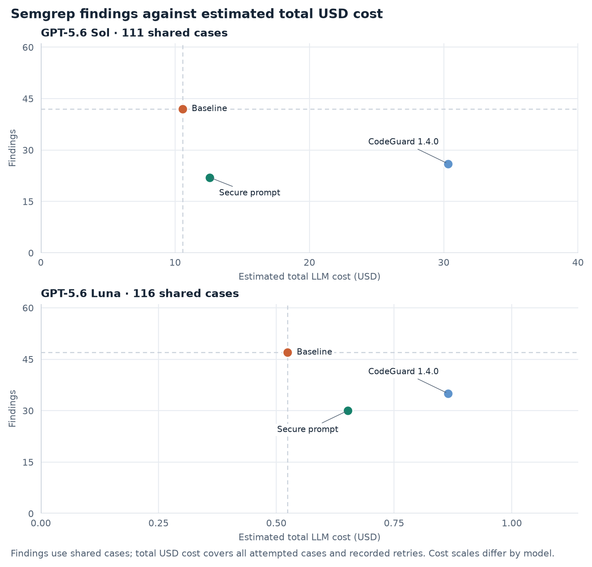
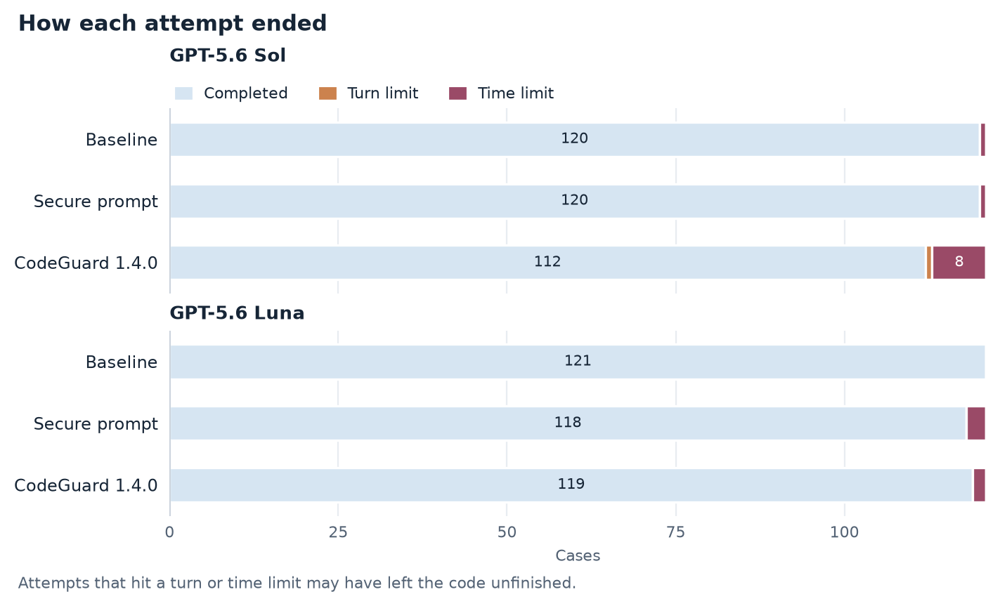
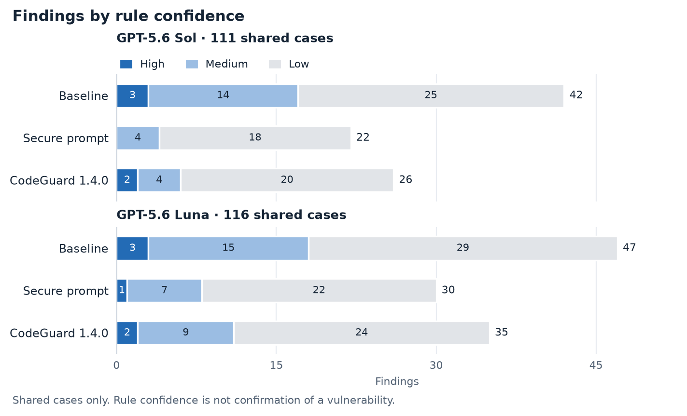

# CodeGuard 1.4.0 on SecurityEval

Findings are Semgrep scanner results, not confirmed vulnerabilities. [Evaluation Results](../index.md) explains how the evaluation works and its limits.

Recorded comparison settings match; harness snapshots differ.

## Key numbers

Findings use shared cases; tokens and costs per case use all attempted cases. n/a means a value was not recorded.

### GPT-5.6 Sol (111 shared cases)

Limits: 16 turns; 600 s generation; 1,200 s per case; output token limit 32,768.

| Condition | Findings | High + Medium | Likely vulnerabilities | Tokens per case | Estimated cost per case (USD) | Estimated total cost (USD) | Total USD vs baseline | Unfinished |
| --- | ---: | ---: | ---: | ---: | ---: | ---: | ---: | ---: |
| Baseline | 42 | 17 | 15 | 42.7K | $0.0872 | $10.55 | — | 1 of 121 (1%) |
| Secure prompt | 22 | 4 | 3 | 44.9K | $0.1040 | $12.59 | +19.4% | 1 of 121 (1%) |
| CodeGuard 1.4.0 | 26 | 6 | 6 | 162.4K | $0.2506 | $30.33 | +187.6% | 9 of 121 (7%) |

### GPT-5.6 Luna (116 shared cases)

Limits: 16 turns; 600 s generation; 1,200 s per case; output token limit 32,768.

| Condition | Findings | High + Medium | Likely vulnerabilities | Tokens per case | Estimated cost per case (USD) | Estimated total cost (USD) | Total USD vs baseline | Unfinished |
| --- | ---: | ---: | ---: | ---: | ---: | ---: | ---: | ---: |
| Baseline | 47 | 18 | 15 | 35.3K | $0.0043 | $0.52 | — | 0 of 121 (0%) |
| Secure prompt | 30 | 8 | 8 | 39.2K | $0.0054 | $0.65 | +24.4% | 3 of 121 (2%) |
| CodeGuard 1.4.0 | 35 | 11 | 9 | 70.1K | $0.0071 | $0.86 | +65.1% | 2 of 121 (2%) |

## Charts

## Cost estimates

USD estimates use rates checked October 1, 2026, including Sol promotional pricing and cache-read discounts. Inspect 0.3.255 omitted cache-write counts, so all non-cached input is conservatively charged at 1.25 times the ordinary input rate. Actual provider charges may differ.

## Data

[results.csv](results.csv) has the summary numbers for each run and epoch, and [samples.csv](samples.csv) has one row per attempt.
